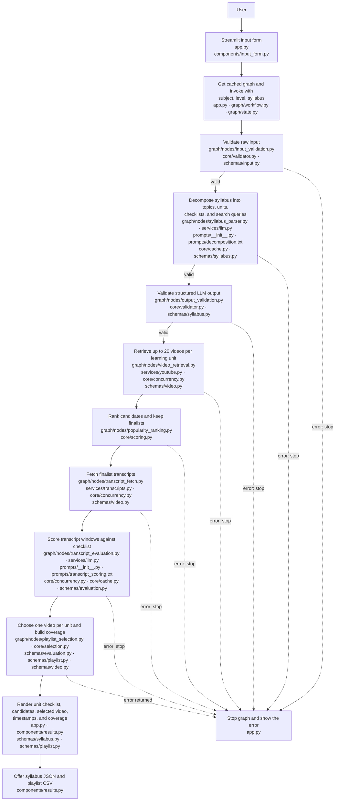

# Application workflow and file map

This guide follows one request from the Streamlit form through the LangGraph
pipeline to the rendered playlist. The boxes name the files that implement each
step; the file map below explains the purpose of every application source,
prompt, test, and project-level support file.

## End-to-end workflow



`graph/workflow.py` connects the nodes in order and carries a shared
`WorkflowState` between them. Nodes return state updates rather than changing
the UI directly. If an upstream node sets `error`, the graph routes to `END`;
playlist selection is the final node and the app checks its returned error too.

### What happens at each step

1. **Collect the request.** `app.py` shows the page and renders
   `components/input_form.py`. The form returns a subject, academic level, and
   syllabus text. Empty subject or syllabus is rejected in the UI before the
   graph is invoked.
2. **Validate input.** `input_validation` passes the form values through
   `core/validator.py` into `SyllabusInput` from `schemas/input.py`. Invalid
   fields become a readable graph error.
3. **Decompose the syllabus.** `syllabus_parser` calls the injected decomposer.
   The production implementation in `services/llm.py` builds Gemini structured
   output messages from `prompts/decomposition.txt`, using the syllabus and
   `SyllabusBreakdown` schema. Structured results are cached in `data/cache/`.
4. **Validate the model result.** `output_validation` parses the result again
   as `SyllabusBreakdown` before any search uses it. Its topics contain
   learning units, each with a checklist and a YouTube `search_query`.
5. **Find candidates.** `video_retrieval` searches once per unique query, in
   bounded parallel work. `services/youtube.py` uses YouTube search and video
   details endpoints, then maps results to `VideoCandidate`. Identical unit
   queries share a fetch, but each unit receives its own unit-keyed copies.
   Raw responses are cached in `data/cache/`.
6. **Shortlist by popularity.** `popularity_ranking` applies deterministic
   log-normalized view, like, and comment scores from `core/scoring.py`.
   Ordinarily, the best five of up to 20 candidates remain per unit.
7. **Fetch transcripts.** `transcript_fetch` deduplicates finalist video IDs
   and retrieves timestamped English/Hindi transcript segments in bounded
   parallel work. `services/transcripts.py` caches results. A missing
   transcript is recorded as `None`, not treated as an error.
8. **Evaluate transcript evidence.** `transcript_evaluation` splits available
   transcripts into roughly 700-word windows and evaluates each against that
   unit's checklist with `prompts/transcript_scoring.txt`. Gemini returns
   `SegmentEvaluation` data; calls run in bounded parallel work and structured
   results are cached. Videos without transcripts produce no evaluations.
9. **Select and report coverage.** `playlist_selection` aggregates a video's
   window evaluations with `core/selection.py`. It selects the highest
   transcript-based decision score for each unit; popularity and views break
   ties. It records covered/mentioned checklist items and the earliest
   explained-evidence timestamp. If no evaluated finalist exists for a unit,
   that unit has no selected playlist item.
10. **Present results.** `app.py` stores the successful breakdown, finalists,
    playlist, and coverage report in Streamlit session state.
    `components/results.py` renders the checklist, inline video links,
    timestamps, candidates, and coverage status. It offers JSON for the
    syllabus breakdown and CSV for a non-empty playlist.

## State passed between stages

`graph/state.py` defines the graph's shared, partially populated
`WorkflowState`. Its important fields are:

| Stage | State fields |
|---|---|
| Form and input validation | `subject`, `level`, `syllabus`, `syllabus_input` |
| Decomposition and output validation | `breakdown` |
| YouTube retrieval and ranking | `candidates`, `finalists` (keyed by unit, such as `1.2`) |
| Transcript retrieval | `transcripts` (keyed by video ID; value may be `None`) |
| Transcript evaluation | `evaluations` (keyed by `unit_key:video_id`) |
| Final selection and UI | `playlist`, `coverage` |
| Error path | `error` |

The schemas that define these values are collected and re-exported by
`schemas/__init__.py`. `build_workflow(...)` accepts injected decomposer,
YouTube client, transcript fetcher, and evaluator implementations. Production
services are initialized lazily; tests use fakes, so importing/building the
workflow does not require API keys or make network calls.

## File map

### UI and orchestration

| File | Purpose and place in the workflow |
|---|---|
| `app.py` | Streamlit entrypoint; displays the form, invokes/caches the compiled graph, manages result session state, and chooses success or error rendering. |
| `components/input_form.py` | Renders the compact subject, level, and syllabus form and returns submitted values. |
| `components/results.py` | Renders topics and units, checklist coverage, selected/finalist video links, timestamps, and JSON/CSV downloads. |
| `components/__init__.py` | Marks the Streamlit components package. |
| `graph/workflow.py` | Builds the LangGraph, lazily resolves production services, injects test doubles, connects nodes, and routes upstream errors to the end. |
| `graph/state.py` | Defines the data contract shared by all graph nodes. |
| `graph/__init__.py` | Marks the orchestration package. |
| `graph/nodes/__init__.py` | Marks the graph-node package. |

### Graph nodes

| File | Purpose and place in the workflow |
|---|---|
| `graph/nodes/input_validation.py` | Converts raw form fields to validated `SyllabusInput`; reports malformed input. |
| `graph/nodes/syllabus_parser.py` | Calls the injected decomposer and places the structured syllabus breakdown in graph state. |
| `graph/nodes/output_validation.py` | Re-validates the decomposer's output as `SyllabusBreakdown`. |
| `graph/nodes/video_retrieval.py` | Creates unit keys, deduplicates search queries, retrieves candidate lists concurrently, and restores unit-specific keys. |
| `graph/nodes/popularity_ranking.py` | Applies deterministic candidate ranking and keeps the configured finalist count per unit. |
| `graph/nodes/transcript_fetch.py` | Deduplicates finalist video IDs and fetches transcript segments concurrently. |
| `graph/nodes/transcript_evaluation.py` | Builds checklist/transcript prompts, chunks transcripts, evaluates them concurrently, and groups structured results by unit and video. |
| `graph/nodes/playlist_selection.py` | Selects each unit's best evaluated finalist and assembles playlist items and checklist coverage entries. |

### Schemas, deterministic logic, and external services

| File | Purpose and place in the workflow |
|---|---|
| `schemas/__init__.py` | Re-exports the public Pydantic models used across the app. |
| `schemas/input.py` | Defines and validates `SyllabusInput` and shared whitespace-stripping behavior. |
| `schemas/syllabus.py` | Defines `ChecklistItem`, `LearningUnit`, `Topic`, and `SyllabusBreakdown`. |
| `schemas/video.py` | Defines YouTube `VideoCandidate` and timestamped `TranscriptSegment`. |
| `schemas/evaluation.py` | Defines structured transcript evidence, segment evaluations, and aggregate video decisions. |
| `schemas/playlist.py` | Defines selected playlist entries and covered/partial/missing coverage reports. |
| `core/__init__.py` | Marks the deterministic-logic package. |
| `core/validator.py` | Performs shared Pydantic validation and formats node errors. |
| `core/scoring.py` | Scores candidates from views, likes, and comments without network or LLM calls. |
| `core/selection.py` | Aggregates transcript rubric labels and penalties, and finds evidence timestamps. |
| `core/concurrency.py` | Provides bounded thread mapping and environment-configured worker counts while preserving result order. |
| `core/cache.py` | Provides cache-key hashing and JSON read/write helpers for structured LLM results. |
| `services/__init__.py` | Marks the external-services package. |
| `services/llm.py` | Loads environment settings, lazily creates Gemini models, builds structured-output helpers, and caches structured responses. |
| `services/youtube.py` | Calls YouTube REST search/details endpoints and caches API responses as video candidates. |
| `services/transcripts.py` | Fetches and caches timestamped YouTube transcript segments; returns `None` when unavailable. |

### Prompts, tests, and project support

| File or path | Purpose |
|---|---|
| `prompts/__init__.py` | Marks the prompt package, loads text prompt files, and builds decomposition chat messages. |
| `prompts/decomposition.txt` | Instructions for converting syllabus text into structured topics, units, checklists, and search queries. |
| `prompts/transcript_scoring.txt` | User rubric and instructions for assessing transcript windows against a unit checklist. |
| `tests/conftest.py` | Shared pytest fixtures and test setup. |
| `tests/test_concurrency.py` | Tests bounded mapping behavior and result ordering. |
| `tests/test_playlist.py` | Tests the playlist-selection node and coverage output. |
| `tests/test_prompts.py` | Tests prompt loading and decomposition-message construction. |
| `tests/test_schemas.py` | Tests Pydantic schema validation. |
| `tests/test_scoring.py` | Tests deterministic popularity ranking. |
| `tests/test_selection.py` | Tests transcript-evaluation aggregation and final scoring helpers. |
| `tests/test_transcript_evaluation.py` | Tests transcript chunking, prompt construction, and evaluation-node behavior. |
| `tests/test_transcripts.py` | Tests transcript fetching and cached/missing transcript behavior. |
| `tests/test_ui.py` | Tests Streamlit-facing UI behavior. |
| `tests/test_validator.py` | Tests shared input/output validation. |
| `tests/test_video_retrieval.py` | Tests query deduplication and per-unit candidate mapping. |
| `tests/test_workflow.py` | Tests graph wiring and end-to-end workflow using injected fakes. |
| `tests/test_youtube.py` | Tests YouTube response mapping and client behavior. |
| `pyproject.toml` | Declares Python/dependency requirements, package configuration, and pytest settings. |
| `uv.lock` | Locks resolved dependencies for reproducible `uv` installs. |
| `.python-version` | Selects the project Python version for the toolchain. |
| `.env.example` | Documents API-key and optional runtime settings; copy to the ignored root `.env` for local use. |
| `.gitignore` | Excludes local secrets, generated Python/build files, caches, and test artifacts. |
| `data/.gitkeep` | Keeps the otherwise generated-data directory in version control. Runtime API and LLM caches are written under `data/cache/` and are gitignored. |
| `README.md` | Quick-start, setup, run, test, and scope overview. |
| `docs/ARCHITECTURE.md` | Authoritative module boundaries and architecture constraints. |
| `docs/PLAN.md` | Milestone status and verification checklist. |
| `docs/WORKFLOW.md` | This end-to-end diagram and file-by-file workflow guide. |
| `AGENTS.md` | Repository-specific contributor and coding-agent guidance. |

## Run and verify

From the repository root:

```bash
uv run streamlit run app.py
uv run pytest -q
```

Tests use injected services and are offline. A live run requires the API keys
documented in `.env.example`; do not add live API calls to tests.
